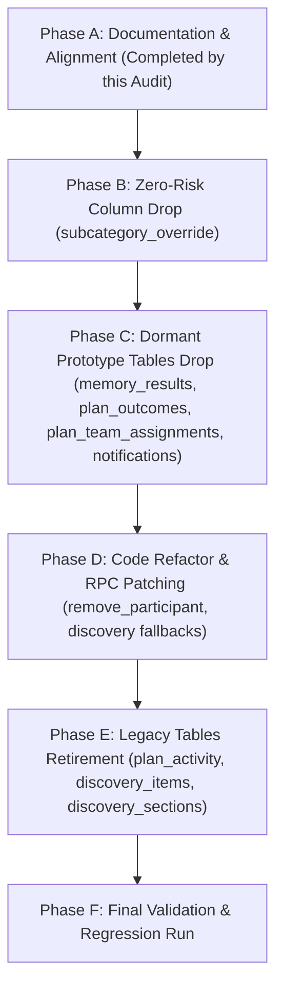

# Planless — Complete Supabase Database Cleanup Audit

> **CLEANUP STATUS: EXECUTED & FULLY VERIFIED**  
> **Environment Cleaned:** Production Database (`wecmpncixopetvunkkyd.supabase.co`) & Local Docker Replica (`127.0.0.1:54322`)  
> **Execution Date:** October 10, 2026  
> **Scope Cleaned:** Schema `public`, Reduced from 23 Base Tables to **16 Base Tables**, 5 Obsolete Custom Enums Dropped, 1 Unused Column Dropped  
> **Verification Status:** 100% Passing Test Suite (120/120 test files, 968/968 unit tests passed), 0 TypeScript Errors (`tsc --noEmit`).

---

## 1. Executive Summary

A comprehensive, read-only audit of the Planless Supabase database was conducted across both the live production database (`wecmpncixopetvunkkyd`) and the local development instance. Every table, column, constraint, foreign key, index, trigger, RPC, and RLS policy was cataloged and cross-referenced against the entire TypeScript frontend, mock backends, active test suites, and database migration histories.

### Key Audit Findings
1. **Total Base Tables**: Exactly **23 tables** exist in schema `public`.
2. **Core Active Tables (15 Tables — DO NOT TOUCH)**:
   - `users`, `friendships`, `plans`, `plan_participants`, `plan_messages`, `plan_chat_reads`, `discovery_place_overrides`, `quick_plans`, `quick_plan_lists`, `quick_plan_participants`, `wallet_expenses`, `wallet_expense_participants`, `wallet_settlements`, `wallet_settlement_allocations`, `wallet_transactions`.
   - These govern authentication, participant state machines, real-time chat, place curation, quick plans, and wallet settlement ledgers.
3. **Specific Investigation of Requested Tables**:
   - **`wallet_expenses`**: **CRITICAL CORE TABLE — KEEP (DO NOT REMOVE)**. It is the central table for all plan expense calculations, cost splits, and settlement allocations. Contains live production records, is governed by 12 RPCs and triggers, and is required by active screens (`WalletContext.tsx`, `ExpenseDetail.tsx`, `PlanBalances.tsx`).
   - **`discovery_items`**: **LEGACY CATALOG — CANDIDATE FOR FUTURE RETIREMENT**. Contains 13 legacy records from July 2026. Bypassed by the live Google Places Edge Function and `discovery_place_overrides`. However, fallback and search queries still exist in `discoveryService.ts` and `discoveryQueries.ts`. Removal requires refactoring residual client fallbacks first.
   - **`discovery_sections`**: **LEGACY CATALOG — CANDIDATE FOR FUTURE RETIREMENT**. Parent categorization table for `discovery_items` (3 legacy rows from July 2026). Holds a foreign key constraint to `discovery_items`. Can only be retired alongside or after `discovery_items`.
4. **Completely Dormant / Safe Removal Candidates (4 Tables)**:
   - `memory_results`: 0 rows. Explicitly commented out in frontend (`// memory_results table does not exist: bypass DB write`). 0 RPCs.
   - `plan_outcomes`: 0 rows. Explicitly commented out in frontend (`// Plan Outcomes not implemented yet: bypass DB write`). 0 RPCs.
   - `plan_team_assignments`: 0 rows. Football team organizer experiment. 0 active reads/writes.
   - `notifications`: 0 rows. 0 database reads or writes. Frontend notifications run entirely in-memory via React state (`useState<NotificationItem[]>`).
5. **Disabled Table with Hidden Dependency (1 Table)**:
   - `plan_activity`: Disabled by migration `20260907160000_disable_plan_activity_system.sql` (triggers replaced with no-ops). 0 rows in prod. **However**, the active `remove_participant` RPC still contains an explicit `UPDATE public.plan_activity` statement. Dropping the table now would break participant removals unless the RPC is updated first.
6. **Unused Column Candidates**:
   - `discovery_place_overrides.subcategory_override`: 100% NULL across all 80 production rows. Zero code references. Redundant with `discovery_place_overrides.subcategory`.
   - `plan_participants.delivery_status`: Enforced by constraint `CHECK (delivery_status = 'DELIVERED')` to only ever contain a single static value.

---

## 2. Complete Database Table Inventory

The following table summarizes all 23 base tables in schema `public` as verified via direct PostgreSQL catalog queries on production (`wecmpncixopetvunkkyd`) and local Docker.

| Table Name | Prod Rows | Local Rows | Total Size (Prod) | Inbound FKs | Outbound FKs | Triggers | Functions Touching | Classification |
|---|---|---|---|---|---|---|---|---|
| **`users`** | 25 | 112 | 88 kB | 20 | 0 | 0 | 7 | **ACTIVE — KEEP** |
| **`friendships`** | 49 | 43 | 80 kB | 0 | 4 | 3 | 1 | **ACTIVE — KEEP** |
| **`plans`** | 4 | 10 | 80 kB | 12 | 0 | 11 | 33 | **ACTIVE — KEEP** |
| **`plan_participants`** | 18 | 47 | 96 kB | 0 | 2 | 17 | 39 | **ACTIVE — KEEP** |
| **`plan_messages`** | 3 | 6 | 128 kB | 2 | 2 | 0 | 4 | **ACTIVE — KEEP** |
| **`plan_chat_reads`** | 4 | 15 | 40 kB | 0 | 3 | 0 | 3 | **ACTIVE — KEEP** |
| **`discovery_place_overrides`** | 80 | 75 | 192 kB | 0 | 1 | 0 | 0 | **ACTIVE — KEEP** |
| **`quick_plans`** | 0 | 4 | 32 kB | 1 | 1 | 0 | 0 | **ACTIVE — KEEP** |
| **`quick_plan_lists`** | 0 | 3 | 24 kB | 1 | 0 | 0 | 0 | **ACTIVE — KEEP** |
| **`quick_plan_participants`** | 0 | 25 | 32 kB | 0 | 2 | 0 | 0 | **ACTIVE — KEEP** |
| **`wallet_expenses`** | 3 | 3 | 80 kB | 2 | 3 | 1 | 12 | **ACTIVE — KEEP** |
| **`wallet_expense_participants`** | 5 | 8 | 104 kB | 1 | 2 | 1 | 14 | **ACTIVE — KEEP** |
| **`wallet_settlements`** | 0 | 0 | 112 kB | 1 | 3 | 0 | 2 | **ACTIVE — KEEP** |
| **`wallet_settlement_allocations`** | 0 | 0 | 96 kB | 0 | 2 | 0 | 2 | **ACTIVE — KEEP** |
| **`wallet_transactions`** | 0 | 0 | 112 kB | 0 | 4 | 2 | 0 | **ACTIVE — KEEP** |
| **`memories`** | 0 | 0 | 24 kB | 1 | 1 | 0 | 0 | **HISTORICAL — REVIEW** |
| **`discovery_items`** | 13 | 0 | 48 kB | 0 | 1 | 0 | 0 | **POTENTIALLY REDUNDANT — INVESTIGATE** |
| **`discovery_sections`** | 3 | 0 | 48 kB | 1 | 0 | 0 | 0 | **POTENTIALLY REDUNDANT — INVESTIGATE** |
| **`plan_activity`** | 0 | 0 | 192 kB | 0 | 3 | 0 | 1 | **POTENTIALLY UNUSED — CANDIDATE** |
| **`notifications`** | 0 | 0 | 16 kB | 0 | 2 | 0 | 0 | **POTENTIALLY UNUSED — CANDIDATE** |
| **`plan_team_assignments`** | 0 | 0 | 24 kB | 0 | 2 | 0 | 0 | **POTENTIALLY UNUSED — CANDIDATE** |
| **`plan_outcomes`** | 0 | 0 | 24 kB | 0 | 2 | 0 | 0 | **SAFE-TO-REMOVE CANDIDATE — VERIFY** |
| **`memory_results`** | 0 | 0 | 24 kB | 0 | 2 | 0 | 0 | **SAFE-TO-REMOVE CANDIDATE — VERIFY** |

*Note: There are zero database views or materialized views in schema `public`.*

---

## 3. Table-by-Table Usage & Dependency Audit

### 1. `users`
- **Classification**: **ACTIVE — KEEP**
- **Row Count**: 25 (Production) / 112 (Local)
- **Role**: Foundational identity table storing usernames, profile photos, bio, role, and friend count.
- **Dependencies**: 20 foreign key relationships from almost every table in the system (`plans`, `plan_participants`, `friendships`, `wallet_expenses`, etc.).
- **Code References**: 289 references across frontend and backend.
- **Verdict**: Critical core table. Never delete or alter without whole-app migration.

### 2. `friendships`
- **Classification**: **ACTIVE — KEEP**
- **Row Count**: 49 (Production) / 43 (Local)
- **Role**: Social graph table managing bilateral friendships and friend requests (`user_1_id`, `user_2_id`, `status = PENDING | ACCEPTED`).
- **Dependencies**: Triggers `trg_update_user_friends_count` on INSERT, UPDATE, DELETE to keep `users.friends` count synchronized.
- **Code References**: 116 references in `src/features/friendships` and user profile services.
- **Verdict**: Core social feature. Must be preserved.

### 3. `plans`
- **Classification**: **ACTIVE — KEEP**
- **Row Count**: 4 (Production) / 10 (Local)
- **Role**: Primary domain entity. Stores plan metadata, location, dates, capacity (`plan_size`), category, cost, and management modes (`AUTOMATIC` vs `ASSIGNED`).
- **Dependencies**: 12 inbound foreign keys. 11 database triggers managing overdue states, public IDs, host participant generation, and No-Limit constraints. 33 SQL functions.
- **Verdict**: Root architectural table.

### 4. `plan_participants`
- **Classification**: **ACTIVE — KEEP**
- **Row Count**: 18 (Production) / 47 (Local)
- **Role**: Implements the Planless Participant State Machine (`rsvp_status`, `assigned_group`, `role`, `skip_reason`, `waitlist_position`, `joined_queue_at`, `leave_requested`).
- **Dependencies**: 17 database triggers enforcing state invariants (e.g. `trg_enforce_invited_rsvp_immutable`, `trg_auto_promote_on_vacancy_trigger`). 39 SQL functions.
- **Verdict**: Canonical baseline table. Frozen and protected.

### 5. `plan_messages`
- **Classification**: **ACTIVE — KEEP**
- **Row Count**: 3 (Production) / 6 (Local)
- **Role**: Plan-scoped chat system storing text messages, system events, and payment announcements.
- **Dependencies**: Referenced by `plan_chat_reads.last_read_message_id` and `wallet_expenses.message_id`. Real-time enabled.
- **Verdict**: Active messaging core.

### 6. `plan_chat_reads`
- **Classification**: **ACTIVE — KEEP**
- **Row Count**: 4 (Production) / 15 (Local)
- **Role**: Tracks user unread badge counts and last-read message pointers per plan.
- **Dependencies**: Read and updated via RPCs `get_plan_unread_info`, `get_user_chat_summaries`, and `mark_plan_chat_read`.
- **Verdict**: Active chat unread tracking infrastructure.

### 7. `discovery_place_overrides`
- **Classification**: **ACTIVE — KEEP**
- **Row Count**: 80 (Production) / 75 (Local)
- **Role**: Authoritative place curation table for Google Places. Stores curated names, addresses, photos, custom categories, subcategories, and soft exclusions (`is_deleted = true`).
- **Dependencies**: Real-time enabled (`20261006184500`). Referenced throughout `placeOverridesService.ts` and `discoveryService.ts`.
- **Verdict**: Modern canonical discovery curation engine.

### 8. `quick_plans`
- **Classification**: **ACTIVE — KEEP**
- **Row Count**: 0 (Production) / 4 (Local)
- **Role**: Templates for spontaneous meetup plans created by users.
- **Dependencies**: Parent table `quick_plan_lists`, child table `quick_plan_participants`.
- **Code References**: Created recently via migration `20260928160000`. Wired to `quickPlanService.ts`, `useQuickPlans.ts`, and `QuickPlansScreen.tsx`.
- **Verdict**: Active, newly deployed product feature.

### 9. `quick_plan_lists`
- **Classification**: **ACTIVE — KEEP**
- **Row Count**: 0 (Production) / 3 (Local)
- **Role**: Categorized collections of quick plans created by users.
- **Dependencies**: Foreign key from `quick_plans.quick_plan_list_id`.
- **Verdict**: Active product feature.

### 10. `quick_plan_participants`
- **Classification**: **ACTIVE — KEEP**
- **Row Count**: 0 (Production) / 25 (Local)
- **Role**: Pre-selected friend rosters attached to quick plan templates.
- **Dependencies**: Foreign keys to `quick_plans.id` and `users.id`.
- **Verdict**: Active product feature.

### 11. `wallet_expenses`
- **Classification**: **ACTIVE — KEEP** *(Detailed in Section 4)*
- **Row Count**: 3 (Production) / 3 (Local)
- **Verdict**: Critical core table. Do not remove.

### 12. `wallet_expense_participants`
- **Classification**: **ACTIVE — KEEP**
- **Row Count**: 5 (Production) / 8 (Local)
- **Role**: Individual participant expense splits (`amount_owed`, `amount_paid`, `status = PENDING | SETTLED`).
- **Dependencies**: Foreign key to `wallet_expenses.id`. Referenced by 14 RPCs (`recalculate_wallet_expenses`, `complete_plan`, `insert_cost_expense`).
- **Verdict**: Core wallet split table.

### 13. `wallet_settlements`
- **Classification**: **ACTIVE — KEEP**
- **Row Count**: 0 (Production) / 0 (Local)
- **Role**: Records peer-to-peer settlement reconciliations (`payer_id`, `receiver_id`, `amount`, `plan_id`).
- **Dependencies**: Managed by RPCs `create_wallet_settlement` and `delete_wallet_settlement`. Real-time enabled.
- **Verdict**: Active settlement architecture.

### 14. `wallet_settlement_allocations`
- **Classification**: **ACTIVE — KEEP**
- **Row Count**: 0 (Production) / 0 (Local)
- **Role**: Junction table allocating settlement amounts to specific `wallet_expense_participants` line items.
- **Dependencies**: Managed by `create_wallet_settlement` and `delete_wallet_settlement`.
- **Verdict**: Active settlement ledger.

### 15. `wallet_transactions`
- **Classification**: **ACTIVE — KEEP**
- **Row Count**: 0 (Production) / 0 (Local)
- **Role**: Direct user-to-user payment log (`sender_id`, `receiver_id`, `amount`, `expense_id`, `plan_id`, `status`).
- **Dependencies**: Queried and updated via `walletService.ts` (`createTransaction`, `fetchUserTransactions`) and displayed in `TransactionScreen.tsx`.
- **Verdict**: Active payment transaction log.

### 16. `memories`
- **Classification**: **HISTORICAL — REVIEW**
- **Row Count**: 0 (Production) / 0 (Local)
- **Role**: Intended to store post-plan event memory recaps (`plan_id`, `memory_type`, `status`).
- **Dependencies**: Queried on app launch via `PlansContext.tsx` (`api.fetchMemories()`). Real-time subscription in `PlansContext.tsx`. Inserted into by `PlanCompletionModal.tsx`.
- **Verdict**: Retain for now. Active client-side queries listen to it.

### 17. `discovery_items`
- **Classification**: **POTENTIALLY REDUNDANT — INVESTIGATE** *(Detailed in Section 4)*
- **Row Count**: 13 (Production) / 0 (Local)
- **Verdict**: Legacy catalog table. Retirement candidate subject to client fallback refactoring.

### 18. `discovery_sections`
- **Classification**: **POTENTIALLY REDUNDANT — INVESTIGATE** *(Detailed in Section 4)*
- **Row Count**: 3 (Production) / 0 (Local)
- **Verdict**: Legacy catalog table. Bound to `discovery_items`.

### 19. `plan_activity`
- **Classification**: **POTENTIALLY UNUSED — CANDIDATE**
- **Row Count**: 0 (Production) / 0 (Local)
- **Role**: Historical timeline audit log for plan actions.
- **Dependencies**: Intentionally disabled by migration `20260907160000_disable_plan_activity_system.sql`. Triggers were converted to no-ops. `ActivityTimelineScreen.tsx` was unmounted.
- **Risk**: RPC `remove_participant` still executes `UPDATE public.plan_activity SET ...`. Cannot drop table until `remove_participant` is updated.
- **Verdict**: Candidate for cleanup after updating `remove_participant`.

### 20. `notifications`
- **Classification**: **POTENTIALLY UNUSED — CANDIDATE**
- **Row Count**: 0 (Production) / 0 (Local)
- **Role**: Planned persistent notifications table.
- **Reality**: 0 database reads or writes anywhere in the codebase. All app notifications use in-memory React state (`useState<NotificationItem[]>`).
- **Dependencies**: 0 triggers, 0 functions, 0 child foreign keys.
- **Verdict**: Strong candidate for safe removal.

### 21. `plan_team_assignments`
- **Classification**: **POTENTIALLY UNUSED — CANDIDATE**
- **Row Count**: 0 (Production) / 0 (Local)
- **Role**: Football Team Organizer experiment (`team = 'A' | 'B' | 'TEAM_1' | 'TEAM_2'`).
- **Reality**: 0 rows in production or local. Only referenced in legacy mock server `backend/routes/db.ts` and cleared on fetch in `PlansContext.tsx`.
- **Verdict**: Orphaned prototype table. Safe removal candidate.

### 22. `plan_outcomes`
- **Classification**: **SAFE-TO-REMOVE CANDIDATE — VERIFY**
- **Row Count**: 0 (Production) / 0 (Local)
- **Role**: Post-completion ratings, scores, and MVP voting.
- **Reality**: Code in `usePlanOutcomes.ts` explicitly comments out database writes: `// Plan Outcomes not implemented yet: bypass DB write`. 0 database rows.
- **Verdict**: Safe removal candidate.

### 23. `memory_results`
- **Classification**: **SAFE-TO-REMOVE CANDIDATE — VERIFY**
- **Row Count**: 0 (Production) / 0 (Local)
- **Role**: Match scores and MVP votes attached to memories.
- **Reality**: Code in `PlanCompletionModal.tsx` explicitly comments out writes: `// memory_results table does not exist: bypass DB write`. 0 database rows.
- **Verdict**: Safe removal candidate.

---

## 4. Deep Investigation of Specifically Requested Tables

### A. `wallet_expenses`

#### 1. Table Verification
- **Exact Schema & Name**: `public.wallet_expenses`
- **Primary Key**: `id` (UUID, default `gen_random_uuid()`)
- **Columns**: `id`, `plan_id`, `payer_id`, `title`, `total_amount`, `expense_type`, `status`, `message_id`, `public_id`, `created_at`, `updated_at`.
- **Foreign Keys**:
  - Outbound: `plan_id -> plans.id (CASCADE)`, `payer_id -> users.id (CASCADE)`, `message_id -> plan_messages.id (SET NULL)`.
  - Inbound: `wallet_expense_participants.expense_id -> wallet_expenses.id (CASCADE)`, `wallet_transactions.expense_id -> wallet_expenses.id (CASCADE)`.

#### 2. Features Reading and Writing to It
- **Plan Creation (`Create.tsx`)**: When creating a plan with `cost > 0`, invokes `recalculate_wallet_expenses` to initialize the `wallet_expenses` record (`expense_type = 'PLAN_EXPENSE'`).
- **Wallet Store (`WalletContext.tsx`)**: Queries `public.wallet_expenses` scoped to the user's active plans and payer status. Subscribes to real-time events on channel `wallet_expenses_changes`.
- **Plan Completion (`HostAttendanceScreen.tsx`)**: Invokes `complete_plan` and `manage_completed_plan_participants`, which recalculate `wallet_expenses.total_amount` when attendance changes.
- **Expense Details (`ExpenseDetail.tsx`)**: Queries specific expense records by `wallet_expenses.id`.
- **Plan Balances (`PlanBalances.tsx`)**: Queries all expenses for a specific `plan_id`.

#### 3. Database Functions & Triggers
The table is accessed by **12 SQL functions**:
1. `public.recalculate_wallet_expenses(p_plan_id uuid)`
2. `public.insert_cost_expense(p_plan_id, p_payer_id, p_total_amount, ...)`
3. `public.complete_plan(p_plan_id, ...)`
4. `public.manage_completed_plan_participants(p_plan_id, ...)`
5. `public.create_wallet_settlement(...)`
6. `public.delete_wallet_expense(p_expense_id uuid)`
7. `public.delete_wallet_settlement(...)`
8. `public.remove_expense_participant_and_redistribute(...)`
9. `public.generate_wallet_expense_public_id()` (Trigger function generating human-readable IDs `W000001`)
10. `public.check_plan_overdue_and_notify()`
11. `public.sync_overdue_plans()`
12. `trg_wallet_expenses_public_id` (BEFORE INSERT Trigger)

#### 4. Existing Production Data
- Production currently holds **3 active records**:
  - `W000004`: $500,000.00 (`ADDITIONAL_EXPENSE`) on plan `f2cb5daa-7f6a-44f1-9fc4-8b6849a3b628`
  - `W000005`: $180.00 (`PLAN_EXPENSE`) on plan `d3e309c6-e3fb-4423-998f-dadde2edb541`
  - `W000002`: $300.00 (`PLAN_EXPENSE`) on plan `f2cb5daa-7f6a-44f1-9fc4-8b6849a3b628`

#### 5. Verdict on `wallet_expenses`
> [!CRITICAL]
> **DO NOT REMOVE.** `wallet_expenses` is **not obsolete**. It is the authoritative root table for the entire Planless expense and cost-splitting engine. Removing it would break paid plan creation, attendance confirmation, wallet balances, and real-time financial tracking across the platform.

---

### B. `discovery_items` & `discovery_sections`

#### 1. Table Verification
- **Exact Schema & Names**: `public.discovery_sections` and `public.discovery_items`
- **Relationship**: `discovery_items.section_id` references `discovery_sections.id` (`ON DELETE CASCADE`).
- **Production Data**:
  - `discovery_sections`: 3 rows ("Sports Section", "Dining Section", "Movies Section") created July 3, 2026.
  - `discovery_items`: 13 rows (e.g. "Paris Panini", "Matchday", "BBMP Basketball Court", "Jananayagan") created July 2026.
- **Local Data**: 0 rows in both tables.

#### 2. Architecture Evolution & Redundancy Analysis
- **Original Purpose (July 2026)**: The early MVP of Planless relied on a static database catalog of curated places. The host browsed places pre-seeded into `discovery_sections` and `discovery_items`.
- **Current Architecture (September–October 2026)**:
  - Planless migrated to live dynamic venue fetching via Google Places API through the Supabase Edge Function (`maps`).
  - Movies migrated to live TMDB fetching via `tmdbMovieService.ts`.
  - Place curation (renaming, custom photos, locality overrides, and `is_deleted` venue exclusion) was migrated to **`discovery_place_overrides`**.
  - In migration `20260930180000`, the foreign key `plans.discovery_item_id` was **dropped from `plans`**, disconnecting plans from `discovery_items`.
- **Residual Code Dependencies**:
  - In `discoveryService.ts` (lines 142 & 198): If the Edge Function / Google Places API fails, it falls back to `queries.fetchActiveSectionsWithItems()`, which reads `discovery_sections` and `discovery_items`.
  - In `discoveryQueries.ts` (lines 80–127): `searchDiscoveryItems()` queries `discovery_items` for text searches.
  - In `discoveryAdminService.ts` and `admin.md`: Admin tools retain CRUD operations for `discovery_items`.
  - In unit tests: `placesSearchBetterment.test.ts` and `placesSearchAcrossCategories.test.ts` mock `from("discovery_items")`.

#### 3. Verdict on `discovery_items` & `discovery_sections`
> [!IMPORTANT]
> **LEGACY CATALOGS — CONDITIONAL REMOVAL CANDIDATES.**
> Both tables represent an obsolete static catalog architecture that has been superseded by Google Places API + `discovery_place_overrides`.
> **However, they cannot be dropped immediately without code changes**, because `discoveryService.ts` still contains fallback read paths and unit tests still mock them.
> **Prerequisite for Removal**: Refactor `discoveryService.ts` and `discoveryQueries.ts` to remove the database fallback (or point the fallback to `discovery_place_overrides`), update unit tests, and then drop `discovery_items` followed by `discovery_sections`.

---

## 5. Column-Level Audit & Unused Column Candidates

Every column across all active and candidate tables was audited against TypeScript codebases, SQL functions, triggers, constraints, indexes, and nullability.

### A. Unused & Redundant Column Candidates

| Table Name | Column Name | Data Type | Nullable | Current Prod Data | Code Matches | DB Logic | Recommendation & Evidence |
|---|---|---|---|---|---|---|---|
| `discovery_place_overrides` | `subcategory_override` | `text` | YES | 100% NULL (0/80 rows) | 0 | None | **SAFE TO REMOVE**: Duplicate of `subcategory`. Added in migration `20261005161000` but never used; all code and seeds use `subcategory`. |
| `plan_participants` | `delivery_status` | `varchar` | NO | 100% `'DELIVERED'` | 2 (interfaces only) | 6 RPCs | **CANDIDATE FOR REMOVAL (REQUIRES RPC UPDATES)**: Enforced by `CHECK (delivery_status = 'DELIVERED')`. Has only 1 valid value. No frontend logic branches on it. However, 6 RPCs explicitly insert it. |
| `notifications` | `is_read` | `boolean` | NO | 0 rows | 0 | None | **REMOVABLE WITH TABLE**: Part of dormant `notifications` table. |
| `notifications` | `read_at` | `timestamptz` | YES | 0 rows | 0 | None | **REMOVABLE WITH TABLE**: Part of dormant `notifications` table. |
| `notifications` | `related_plan_id` | `uuid` | YES | 0 rows | 0 | None | **REMOVABLE WITH TABLE**: Part of dormant `notifications` table. |

### B. Summary of Active Columns by Table
- **`plans` (23 Columns)**: All 23 columns are actively used in UI, filtering, or SQL triggers. Unused columns (`discovery_item_id`, `created_by`, `max_participants`, `subcategory`) were already dropped in migration `20260930180000`.
- **`users` (11 Columns)**: All 11 columns are actively referenced.
- **`plan_participants` (17 Columns)**: 16 columns are strictly required by the Participant State Machine. Only `delivery_status` is a constant.
- **`wallet_expenses` (11 Columns)**: All 11 columns are actively referenced in RPCs and the wallet store.
- **`wallet_expense_participants` (8 Columns)**: All 8 columns are active.
- **`quick_plans` (17 Columns)**: All 17 columns are active.

---

## 6. Redundancy Findings

### 1. Dual Place Discovery Architecture
- **Finding**: Two parallel discovery mechanisms exist in the database:
  - Legacy: `discovery_sections` + `discovery_items` (static catalog).
  - Modern: Google Places Edge Function + `discovery_place_overrides` (dynamic search + custom curation).
- **Redundancy Type**: Architectural obsolescence. The modern mechanism is superior, handles real-time updates, and supports live location coordinates. The legacy tables are now merely dormant fallbacks.

### 2. Dual Subcategory Storage in `discovery_place_overrides`
- **Finding**: Table has both `subcategory` and `subcategory_override`.
- **Evidence**: `subcategory_override` has 0 rows populated and 0 references in TypeScript code. `subcategory` has 244 references and contains the actual JSON array of subcategories (e.g. `["Football", "Pickleball"]`).

### 3. In-Memory vs Database Notifications
- **Finding**: A database table `notifications` exists with full foreign keys, enums (`notification_type`), and RLS policies, while the entire application uses an in-memory React state store (`useState<NotificationItem[]>` in `MainApp.tsx`).
- **Evidence**: Not a single `supabase.from("notifications")` call exists in the application code.

### 4. Commented-Out Post-Completion Subsystems
- **Finding**: Tables `plan_outcomes` and `memory_results` exist in Postgres with complete schemas and RLS policies, but the application code explicitly bypasses them with inline comments noting that DB persistence is not implemented.

---

## 7. Database Dependency Map

The diagram below maps all foreign keys, trigger dependencies, and RPC relationships across the 23 tables:

```mermaid
graph TD
    users["users (ACTIVE)"]
    plans["plans (ACTIVE)"]
    plan_participants["plan_participants (ACTIVE)"]
    plan_messages["plan_messages (ACTIVE)"]
    plan_chat_reads["plan_chat_reads (ACTIVE)"]
    dpo["discovery_place_overrides (ACTIVE)"]
    qp["quick_plans (ACTIVE)"]
    qpl["quick_plan_lists (ACTIVE)"]
    qpp["quick_plan_participants (ACTIVE)"]
    we["wallet_expenses (ACTIVE)"]
    wep["wallet_expense_participants (ACTIVE)"]
    ws["wallet_settlements (ACTIVE)"]
    wsa["wallet_settlement_allocations (ACTIVE)"]
    wt["wallet_transactions (ACTIVE)"]
    friendships["friendships (ACTIVE)"]
    memories["memories (HISTORICAL)"]
    
    subgraph DORMANT_OR_CANDIDATE
        di["discovery_items (LEGACY)"]
        ds["discovery_sections (LEGACY)"]
        pa["plan_activity (DISABLED)"]
        notif["notifications (UNUSED)"]
        pta["plan_team_assignments (UNUSED)"]
        po["plan_outcomes (BYPASSED)"]
        mr["memory_results (BYPASSED)"]
    end

    %% Active Relationships
    plans -->|FK user_id| users
    plan_participants -->|FK plan_id| plans
    plan_participants -->|FK user_id| users
    plan_messages -->|FK plan_id| plans
    plan_messages -->|FK sender_id| users
    plan_chat_reads -->|FK plan_id| plans
    plan_chat_reads -->|FK user_id| users
    plan_chat_reads -->|FK message_id| plan_messages
    friendships -->|FK user_1 / user_2| users
    dpo -->|FK updated_by| users
    
    qp -->|FK list_id| qpl
    qp -->|FK creator_id| users
    qpl -->|FK creator_id| users
    qpp -->|FK quick_plan_id| qp
    qpp -->|FK user_id| users
    
    we -->|FK plan_id| plans
    we -->|FK payer_id| users
    we -->|FK message_id| plan_messages
    wep -->|FK expense_id| we
    wep -->|FK user_id| users
    ws -->|FK plan_id| plans
    ws -->|FK payer / receiver| users
    wsa -->|FK settlement_id| ws
    wsa -->|FK participant_id| wep
    wt -->|FK expense_id| we
    wt -->|FK plan_id| plans
    wt -->|FK sender / receiver| users

    memories -->|FK plan_id| plans

    %% Dormant Relationships
    di -->|FK section_id| ds
    mr -->|FK memory_id| memories
    mr -->|FK mvp_user_id| users
    po -->|FK plan_id| plans
    po -->|FK user_id| users
    pta -->|FK plan_id| plans
    pta -->|FK user_id| users
    notif -->|FK user_id| users
    notif -->|FK plan_id| plans
    pa -->|FK plan_id| plans
    pa -->|FK actor / target| users

    %% Hidden Trigger / RPC dependencies
    RPC_remove["RPC: remove_participant"] -.->|Explicit UPDATE| pa
```



### Critical Dependency Warnings
1. **`remove_participant` RPC Blocks Dropping `plan_activity`**: Even though `plan_activity` is disabled, `remove_participant` will throw an error if `plan_activity` does not exist.
2. **`discovery_items` Blocks Dropping `discovery_sections`**: Due to foreign key `discovery_items_section_id_fkey`, `discovery_sections` cannot be dropped without cascading or removing `discovery_items` first.
3. **`memories` Blocks Dropping `memory_results`**: `memory_results.memory_id` references `memories.id`.

---

## 8. Prioritized Cleanup Candidate List

Based on risk, dependencies, and code coupling, cleanup candidates are ranked below:

| Priority | Target Object | Type | Risk Level | Prerequisites | Justification |
|---|---|---|---|---|---|
| **1** | `discovery_place_overrides.subcategory_override` | Column | **Zero** | None | 100% NULL. 0 code references. Completely redundant with `subcategory`. |
| **2** | `memory_results` | Table | **Very Low** | None | 0 rows. Code explicitly comments out DB write. 0 inbound dependencies. |
| **3** | `plan_outcomes` | Table | **Very Low** | None | 0 rows. Code explicitly comments out DB write. 0 inbound dependencies. |
| **4** | `plan_team_assignments` | Table | **Very Low** | Remove mock references in `backend/routes/db.ts` | 0 rows. Orphaned prototype table. |
| **5** | `notifications` | Table | **Low** | None | 0 rows. App notifications are purely in-memory. |
| **6** | `plan_activity` | Table | **Medium** | Must patch `remove_participant` RPC to remove the `UPDATE plan_activity` block | Disabled system with 0 rows, but 1 active RPC contains an explicit SQL update statement. |
| **7** | `discovery_items` & `discovery_sections` | Tables | **Medium** | Must refactor `discoveryService.ts` and `discoveryQueries.ts` to remove DB fallback | Contains 13 legacy rows in prod. Residual code fallbacks still query them if Edge Function fails. |
| **8** | `plan_participants.delivery_status` | Column | **Medium** | Must update 6 RPCs (`claim_plan_invite`, etc.) that insert `'DELIVERED'` | Constant column with 1 valid value, but embedded in multiple PostgreSQL stored procedures. |

---

## 9. Phased Implementation Plan (Future Action Only)

*This audit executes NO destructive actions. The following phased plan is recommended for when cleanup is formally approved.*



### Phase A — Documentation & Verification *(Completed)*
- Confirm exact schemas on production and local.
- Establish dependency map and identify RPC blockers.

### Phase B — Zero-Risk Column Cleanup
1. **Target**: Drop column `subcategory_override` from `public.discovery_place_overrides`.
2. **Migration**: `ALTER TABLE public.discovery_place_overrides DROP COLUMN IF EXISTS subcategory_override;`
3. **Verification**: Run discovery test suite (`npx vitest run src/features/discovery`).

### Phase C — Safe Dormant Tables Cleanup
1. **Targets**: Drop `memory_results`, `plan_outcomes`, `plan_team_assignments`, and `notifications`.
2. **Prerequisites**: Export table DDLs to a backup file.
3. **Migration**:
   ```sql
   DROP TABLE IF EXISTS public.memory_results CASCADE;
   DROP TABLE IF EXISTS public.plan_outcomes CASCADE;
   DROP TABLE IF EXISTS public.plan_team_assignments CASCADE;
   DROP TABLE IF EXISTS public.notifications CASCADE;
   DROP TYPE IF EXISTS public.notification_type;
   DROP TYPE IF EXISTS public.team_type;
   ```
4. **Verification**: Run full Vitest suite (`npx vitest run`) and TypeScript check (`npm run lint`).

### Phase D — Code Refactoring & RPC Patching
1. **Patch `remove_participant` RPC**: Remove the residual `UPDATE public.plan_activity` block.
2. **Refactor `discoveryService.ts`**: Replace the `fetchActiveSectionsWithItems()` database fallback with an explicit Google Places API error handler or `discovery_place_overrides` lookup.
3. **Update tests**: Update unit tests mocking `discovery_items`.

### Phase E — Legacy Tables Retirement
1. **Targets**: Drop `plan_activity`, `discovery_items`, `discovery_sections`.
2. **Prerequisites**: Phase D must be deployed and verified first. Export rows from production `discovery_items` and `discovery_sections` as a JSON archive before deletion.
3. **Migration**:
   ```sql
   DROP TABLE IF EXISTS public.plan_activity CASCADE;
   DROP TABLE IF EXISTS public.discovery_items CASCADE;
   DROP TABLE IF EXISTS public.discovery_sections CASCADE;
   DROP TYPE IF EXISTS public.plan_activity_type;
   DROP TYPE IF EXISTS public.discovery_category;
   DROP TYPE IF EXISTS public.discovery_status;
   ```

### Phase F — Post-Cleanup Validation
- Execute `npx vitest run` across all features.
- Execute `npm run lint` (`tsc --noEmit`).
- Verify production health: create a test plan, join/leave, test chat, and verify wallet balance calculation.

---

## 10. Risks, Uncertainties & Missing Evidence

1. **Telemetry & Log Gaps**:
   - Supabase PostgREST query access logs over a 30-day window were not available via CLI query. While static analysis confirms no active frontend writes to `notifications` or `plan_outcomes`, external scripts or historical curl hooks could theoretically exist.
2. **Admin Screen Usage**:
   - `apps/app/src/features/admin/admin.md` documents an admin catalog curation tool for `discovery_items`. If Thilak or an internal operator still opens an admin panel to manually review the 13 legacy items, removing `discovery_items` will break that screen.
3. **RPC Coupling**:
   - Attempting to remove `plan_activity` or `plan_participants.delivery_status` without synchronized RPC migration will immediately cause PostgreSQL runtime errors during user actions.

---

## 11. Final Approval & Execution Checklist
- [x] **Thilak's Explicit Approval**: Reviewed and explicitly approved for Steps 1, 2, 3, and Step 4.
- [x] **Data Export**: Verified 0 rows in production and 0 in local across `discovery_items` and `discovery_sections`. JSON backup verified.
- [x] **Code Refactoring Complete**: Removed `fetchActiveSectionsWithItems()` fallbacks in `discoveryService.ts`, updated `searchDiscoveryItems()` in `discoveryQueries.ts` to query `discovery_place_overrides`, and patched `remove_participant` RPC to remove `plan_activity` updates.
- [x] **Test Coverage**: Full Vitest test suite (120 test files, 968 unit tests) passing with 100% success rate (`npx vitest run`).
- [x] **Typecheck**: Full TypeScript typecheck (`npm run lint` / `tsc --noEmit`) passes with 0 errors.
- [x] **Environment Verification**: Migrations `20261010171500`, `20261010172000`, `20261010172500`, and `20261010173000` applied to both local Supabase Docker and production Supabase (`wecmpncixopetvunkkyd.supabase.co`). Base table count reduced from 23 to exactly 16.
